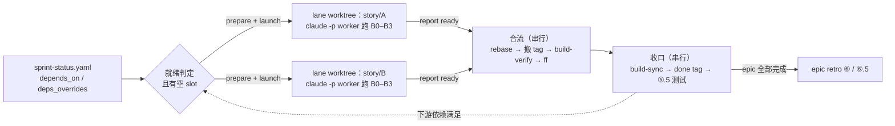
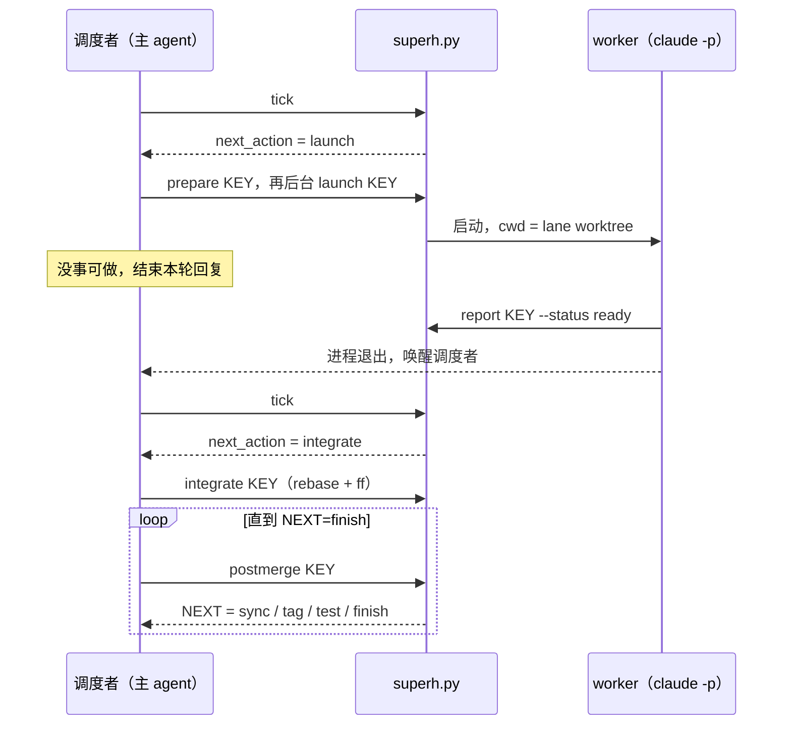
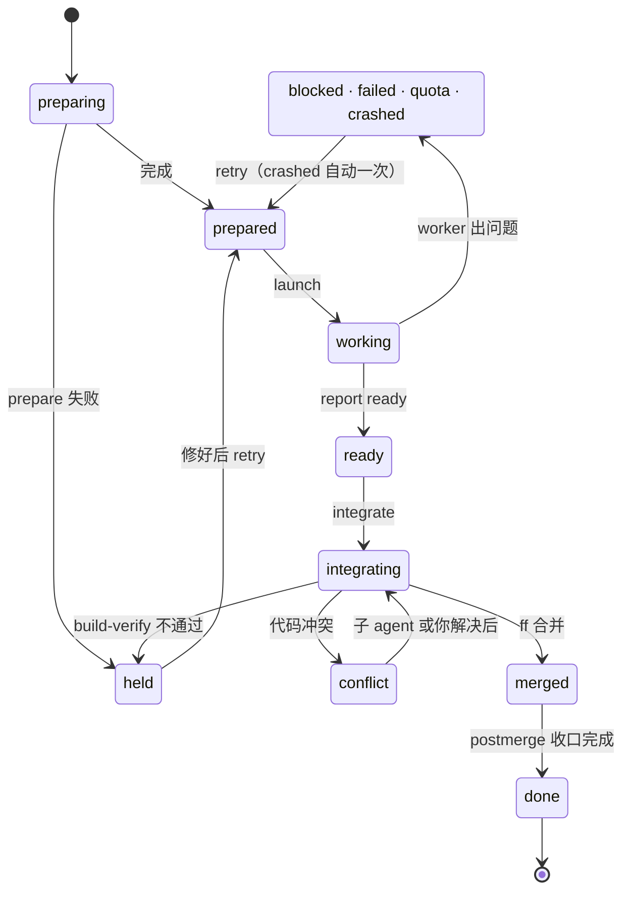

# super-harness

> [my-cc-plugin](../../README.md) marketplace 的一部分，安装方式见那里。

harness-zh 一次推进一条 story。super-harness 在它上面加一层调度：互不依赖的 story 各开一个 git worktree，各起一个 headless Claude Code 进程同时跑，跑完按顺序合回 sprint 分支，再串行完成 build-sync、测试和 epic retro。

每条 story 内部仍然是 harness-zh 的流水线（bmad-build-auto → build-verify → codex → follow-up review），super-harness 不改它，只负责「哪几条可以一起跑」和「跑完怎么合回来」。

设计说明见 [architecture.md](architecture.md)，思路来自 [deepseek-ai/dsh-superagent-prototype](https://github.com/deepseek-ai/dsh-superagent-prototype)。

## 架构一览

图文版在 [`docs/architecture.html`](docs/architecture.html)：单个文件，不依赖网络，克隆仓库后直接用浏览器打开。里面有 6 张图（整体结构、两路并行的时间线、tick 决策、lane 状态机、合流流程、收口），以及就绪规则、冲突处理、状态文件和失败恢复的对照表。下面是其中三张的简化版。

### 一条 story 怎么走完



并行的只有 worker 那一段（B0–B3），各在自己的 worktree 和分支上。合流、收口、retro 要写共享账本或共用测试环境，在主 worktree 里一条一条做。

### 一轮调度



调度者的每个决定都来自 `superh.py` 的结构化输出。状态落在 `.git/super-harness/`，每个文件只有一个写入者，任何一步被打断，下次 tick 都能从磁盘接着走。

### 一条 lane 的状态



trouble、conflict、held 是需要你处理的状态，`/super-harness:board` 会把它们排在最前面。

## 前置条件

- harness-zh ≥ 0.2.1，并且已经在项目里执行过 `/harness-zh:init`
- git ≥ 2.38（合流用到 `git rebase --update-refs`）
- `claude` CLI 在 PATH 里
- 项目用 BMad sprint-planning 生成 `sprint-status.yaml`

## 安装

```
/plugin install super-harness@my-cc-plugin
```

然后在项目根目录执行：

```
/super-harness:init
```

它会检查前置条件，把脚本和 prompt 投递到 `.claude/super-harness/`，并告诉你 sprint-status 里有多少 story 声明了依赖。新生成的文件需要提交进 git 或加进 `.gitignore`，因为合流要求主 worktree 干净。

## 让 story 能并行

super-harness 只并行它确认互不依赖的 story。依赖信息有两个来源：

1. `sprint-status.yaml` 里的 `depends_on`（BMad 多行块格式）：

   ```yaml
   development_status:
     3-2-digest-delivery:
       status: backlog
       depends_on: [3-1-digest-model]
     3-3-email-template:
       status: backlog
       depends_on: []        # 明确声明独立
   ```

2. `.claude/super-harness/config.yaml` 的 `deps_overrides`，优先级更高。

两处都没写的 story，默认按串行处理（`no_deps_policy: serial`），这时行为和 harness-zh 一样。确认同一 epic 内的 story 基本独立时，可以改成 `epic-parallel`。

依赖要等上游 story 合入并 build-sync 为 done 才算满足，所以下游 story 开工时一定能看到上游代码。

## 使用

| 命令 | 作用 |
|---|---|
| `/super-harness:run --dry-run` | 预览：哪些 story 现在就能并行、其余在等什么 |
| `/super-harness:run` | 开跑，并发数取 config 的 `max_slots`（默认 2） |
| `/super-harness:run --slots 3` | 本次改用 3 路 |
| `/super-harness:board` | 看状态：先列需要你处理的 lane |

调度者在没事可做时会结束当前回复，某一路 worker 跑完时自动醒来继续。**跑的过程中不要关掉这个 Claude Code 会话**，否则在跑的 worker 会一起结束（下次运行时会自动续作一次）。

某一路出问题时只停这一路，其他照常推进。看板会给出接手方式：

```
cd <worktree> && claude --resume <session>                      # 进入那一路的会话
python3 .claude/super-harness/scripts/superh.py retry <KEY>     # 修好后让 worker 续作
python3 .claude/super-harness/scripts/superh.py abandon <KEY> --yes   # 放弃这一路
```

## 配置

`.claude/super-harness/config.yaml`，每一项都有注释。常改的几项：

| 键 | 默认 | 说明 |
|---|---|---|
| `max_slots` | 2 | 同时运行的 worker 数，token 消耗大致按它线性增长 |
| `no_deps_policy` | serial | 没写依赖的 story 怎么处理：`serial` / `epic-parallel` |
| `retro_barrier` | true | 下一个 epic 要等上一个 epic 的 retro done |
| `worktree_root` | `<仓库名>.worktrees`（仓库旁边） | lane worktree 放在哪 |
| `copy_paths` / `link_paths` | harness、commands、skills、_bmad | 没进 git 的基建文件怎么带进 worktree。这些路径必须被 `.gitignore` 忽略，软链要写成不带结尾斜杠的 `/node_modules`；`superh.py doctor` 可以检查 |
| `prepare_command` | 空 | 开 lane 后执行的命令，例如 `pnpm install --frozen-lockfile` |
| `worker_permission_mode` | bypassPermissions | worker 的权限模式 |

## 合流时会自动处理的冲突

每一路的 bmad-build-auto 都可能改 `sprint-status.yaml`、`deferred-work.md` 和 `epic-<N>-context.md`，合流时这三个文件由脚本自动处理：

| 文件 | 处理 |
|---|---|
| `sprint-status.yaml` | 取 sprint 分支版本，本 story 的状态随后由 build-sync 写回 |
| `deferred-work.md` | 两边新增的条目都保留 |
| `epic-<N>-context.md` | 缓存文件，取 sprint 分支版本 |

其他文件的冲突交给一个专门的子 agent 解决。它解决不了，这一路就停在冲突状态等你处理。

## 测试

```bash
bash plugins/super-harness/scripts/superh_test.sh
```

用一个假的 `claude` 可执行文件扮演 worker，在临时仓库里跑完就绪判定、开 lane、启动、两路并行合流（含账本冲突自动消解和 tag 搬迁）、代码冲突、重试和放弃，不消耗 token。CI 的 source-tests job 会执行它。

## 版本

见 [changelog.md](changelog.md)。
