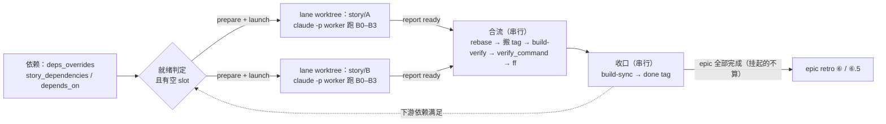
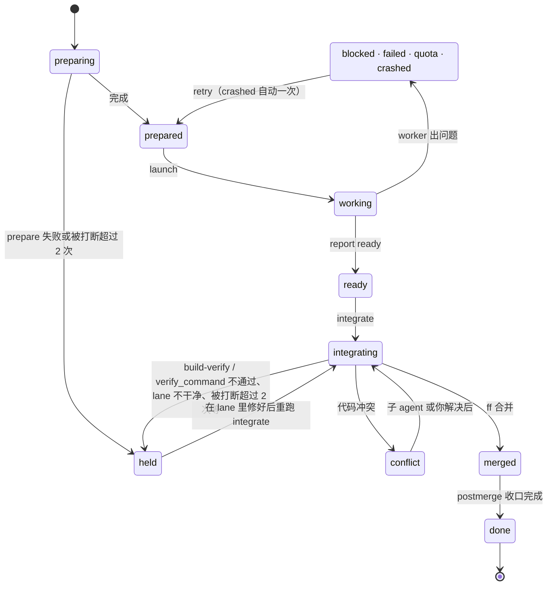

# super-harness

> [my-cc-plugin](../../README.md) marketplace 的一部分，安装方式见那里。

在 [BMad Method](https://github.com/bmad-code-org/BMAD-METHOD) 之上跑 sprint 的编排 plugin，面向一个开发者带多个 AI 子 agent 的工作方式。BMad 产出规划文档（PRD、architecture、epics、sprint-status），super-harness 按 `sprint-status.yaml` 把 backlog story 一条条推进完：每条 story 跑一次 `bmad-build-auto`（规划、实现、多层 review、commit），事后审计提交区间，codex 没挂进 build 时补一轮外部 codex review 和修复，按需再跑一轮 follow-up review，然后同步 sprint-status 和 deferred 账本，epic 收尾时做 retrospective。

流水线里没有单独的测试阶段。单元测试和集成测试在实现阶段由 `bmad-build-auto` 写并实跑，e2e 和验收测试交给测试团队，见下文「测试分工」。

有两种跑法，走的是同一份流水线手册（`pipeline.md`）：

| 命令 | 怎么跑 | 适合 |
|---|---|---|
| `/super-harness:run-inline` | 单路，在当前会话里一条一条跑，每一步都看得见 | 调试、优化流水线；story 之间依赖不清楚 |
| `/super-harness:run` | 多路并行：互不依赖的 story 各开一个 git worktree、各起一个 headless Claude Code 进程同时跑，跑完按顺序合回 sprint 分支（合入前可以先在合流后的代码上跑一遍项目测试），再串行完成 build-sync 和 epic retro | 依赖已经声明清楚，想缩短整个 sprint 的时间 |

0.2.0 起 harness-zh 并入本 plugin，harness-zh 不再单独维护。从 harness-zh 迁移的步骤见下文「安装」。

单条 story 的执行手册是 [pipeline.md](pipeline.md)。harness 整体设计（部署模型、状态机、retro 闭环、config 提取）见 [architecture.md](architecture.md)，并行调度的设计见 [architecture-parallel.md](architecture-parallel.md)，思路来自 [deepseek-ai/dsh-superagent-prototype](https://github.com/deepseek-ai/dsh-superagent-prototype)。

## 并行调度一览

图文版在 [`docs/architecture.html`](docs/architecture.html)：单个文件，不依赖网络，克隆仓库后直接用浏览器打开。里面有 6 张图（整体结构、两路并行的时间线、tick 决策、lane 状态机、合流流程、收口），以及就绪规则、冲突处理、状态文件和失败恢复的对照表。下面是其中三张的简化版。

### 一条 story 怎么走完



并行的只有 worker 那一段（B0–B3，按 pipeline.md 的 lane 模式执行），各在自己的 worktree 和分支上。合流、收口、retro 要写共享账本，在主 worktree 里一条一条做。

### 一轮调度


调度者的每个决定都来自 `superh.py` 的结构化输出。状态落在 `.git/super-harness/`，每个文件只有一个写入者，任何一步被打断，下次 tick 都能从磁盘接着走。

### 一条 lane 的状态



trouble、conflict、held 是需要你处理的状态，`/super-harness:board` 会把它们排在最前面。held 都带一个 `hold_kind` 说明原因，看板按它给出接手命令；prepare 阶段 held 的 lane 修好原因后用 `abandon --yes` 放弃，story 回到 backlog 重新排队。

## 测试分工

| 哪一层 | 谁来做 | 怎么保证 |
|---|---|---|
| 单元测试、集成测试 | B1 的 `bmad-build-auto` | spec 的 `## Verification` 段写验证命令并实跑，至少包含 `harness-project-config.yaml` 里的 `verification_commands`；step-03 的 Matrix Test Audit 要求 I/O 矩阵每一行都有跑过且通过的测试，否则 story 直接 blocked；step-04 的 verification-gap 审查层找没有测试兜住的行为改动 |
| 合流后的回归 | `/super-harness:run` 的合流验证门 | `parallel.yaml` 配了 `verify_command` 时，lane 合入 sprint 分支前在合流后的代码上跑一遍，失败就挂起这一路，见「合流验证门」 |
| e2e、验收测试 | 测试团队 | harness 不做 |

`verification_commands` 和 `verify_command` 是两个配置：前者写进 B1 的 prompt，由实现子 agent 执行；后者由 `superh.py integrate` 自己执行，只在并行模式合流时用。两者可以填同一组命令。

0.3.0 之前流水线里有一个 ⑤.5 测试阶段（`/super-harness:run-test`，ATDD 红相加 Playwright e2e）。它在 story done 之后才跑，红了也不拦，没配 e2e 的项目每条 story 都白起一个子 agent，所以 0.3.0 把它删了。

## 前置条件

所有跑法都需要：

- BMad Method ≥ 6.11（实测 6.12.4），至少装 Core + BMM；集成选 Claude Code，输出目录保持默认的 `_bmad-output`。安装：`npx bmad-method install`。
- [uv](https://docs.astral.sh/uv/)：BMad 6.12 通过 `uv run _bmad/scripts/render_skill.py` 启动每个 skill，没有 uv 时 `bmad-build-auto` 直接 HALT。安装：`curl -LsSf https://astral.sh/uv/install.sh | sh`。
- 项目用 BMad sprint-planning 生成了 `sprint-status.yaml`。

`/super-harness:run` 另外需要：

- git ≥ 2.38（合流用到 `git rebase --update-refs`）
- `claude` CLI 在 PATH 里（worker 是 headless `claude -p` 进程）

可选：codex plugin（`/plugin marketplace add openai/codex-plugin-cc`，`/plugin install codex@openai-codex`），用来做跨模型的对抗式 review。项目在 `_bmad/custom/bmad-build-auto.toml` 里把 codex 挂成 review layer 时，codex 在 `bmad-build-auto` 内部跑；没挂时流水线在 build 之后单独跑一轮。codex 不可用时 story 照常往下走，留下 `<KEY>.codex-skipped.json`，之后用 `/super-harness:codex-catchup` 补跑。

`/super-harness:run-inline` 和 `/super-harness:run` 启动时都会用 `scripts/check_bmad_runtime.sh` 检查 BMad、uv 和嵌套子 agent，缺了就停下并给出修复命令。

## 安装

```
/plugin install super-harness@my-cc-plugin
```

然后在项目根目录执行：

```
/super-harness:init
```

它把资产投递到 `.claude/harness/`，装 git pre-commit hook，检查并行调度的前置条件；BMad 规划文档已经齐的话，接着从中提取字段填 `harness-project-config.yaml`。并行配置 `.claude/harness/parallel.yaml` 只在不存在时投放，之后不会被覆盖。

init 和 update 都要在仓库根目录执行，在子目录里会直接停下。init 会往项目的 `.gitignore` 里补三行：

```
/.claude/harness/*
!/.claude/harness/harness-project-config.yaml
!/.claude/harness/parallel.yaml
```

部署进来的脚本和文档不进 git，两份配置进 git。init 结束后把 `.gitignore`、这两份配置和新建的 `deferred-work.md` 提交一次再开始跑 story，工作区不干净时 `run` 和 `run-inline` 都会停下。仓库还没有任何 commit 的话，这次就是初始提交。

plugin 升级后执行 `/super-harness:update`，它只刷新资产，不动两份配置。从 super-harness 0.1.0 升上来时，`.claude/super-harness/config.yaml` 会被原样搬到 `.claude/harness/parallel.yaml`，旧目录确认后可以删掉。

### 从 harness-zh 迁移

1. `/plugin install super-harness@my-cc-plugin`
2. 在项目根目录跑 `/super-harness:init`。`harness-project-config.yaml`、`harness/<KEY>/*` tag 和 sprint 状态都原样沿用。harness-zh 以前复制进 `.claude/commands/` 的命令副本会被备份后删除，你自己写的命令不受影响。
3. `/plugin uninstall harness-zh`。两个 plugin 都往 `.claude/harness/` 写资产，留着旧的，下次误跑 `/harness-zh:update` 会把资产刷回旧版。

做到一半的 story 用 `/super-harness:run-inline --continue` 接着跑。原来的 `/harness-zh:run` 对应现在的 `/super-harness:run-inline`，参数相同。

## 命令

| 命令 | 作用 | 什么时候用 |
|---|---|---|
| `/super-harness:init` | 首次 bootstrap：投递资产、装 hook、检查前置条件，BMad 文档齐时填 `harness-project-config.yaml`（merge 模式，支持 `--dry-run` / `--force`） | 每个项目一次；BMad 文档补齐后可重跑 |
| `/super-harness:update` | 升级 plugin 后刷新项目里的资产副本 | 每次 `/plugin marketplace update` 之后 |
| `/super-harness:run-inline` | 单路主循环，参数 `--story [<key>]` / `--epic [<num>]` / `--continue` / `--dry-run` | 日常，或调试流水线 |
| `/super-harness:run` | 多路并行调度，参数 `--slots <N>` / `--dry-run` | 依赖声明清楚之后 |
| `/super-harness:board` | 并行调度看板，先列需要你处理的 lane | 并行跑起来之后 |
| `/super-harness:codex-catchup` | 补跑因 codex 不可用而跳过的 review + 修复 | codex 恢复后 |
| `/super-harness:upgrade-deferred-work` | 复测 `deferred-work.md` 的 schema v1 符合度，在 advisory 和 strict 之间切换 | 按需 |
| `/super-harness:report-issue` | 自动收集版本、sprint 状态、halt 现场，用 `gh` 给 `Niutie/my-cc-plugin` 提 issue | halt 或想反馈时 |

## 跑的过程中看什么

`run-inline` 在当前会话里执行，计划、每个阶段的子 agent 和脚本输出、每条 story 结束时的进度都直接显示；每条 story 对应一个 `Sprint: <key>` 任务。`run` 的状态用 `/super-harness:board` 看。另开终端可以跑下面这些只读命令，不影响运行：

```bash
python3 .claude/harness/scripts/sprint-status.py count             # backlog 剩几条 / 总数
python3 .claude/harness/scripts/superh.py plan                     # 每条 story 的状态和在等什么（两种模式都能用）
python3 .claude/harness/scripts/harness-state.py <KEY> --plain     # 某条 story 走到哪一步、下一步做什么
python3 .claude/harness/scripts/harness-state.py --in-flight       # 开了头还没做完的 story
```

跑的过程中发现的问题按要不要你马上处理分四处：

| 在哪看 | 内容 |
|---|---|
| 会话里的 halt 框（并行模式是看板的「需要你处理」） | 流水线处理不了、停下来等你的问题，附处理选项。处理完用 `--continue` 接着跑 |
| 看板的「待你确认」（只有并行模式） | worker 和调度者按推荐项做了、没有停下来问你的决定。有空时批量确认，或推翻其中一条，见「不用一直守着」 |
| `deferred-work.md` | review 和 codex 发现、决定推迟的问题（`FU-` 条目）。`grep_deferred_buckets.sh --list` 按归属汇总，`grep_deferred_status.sh <KEY>` 看某条 story 相关的。目标是后面某条 story 的，会在那条 story 开工时自动带给 bmad-build-auto；build-sync 导入的延后项目标是所在 epic，同 epic 后面的 story 开工时也会带上，epic retro 再把剩下的逐条分到具体去处 |
| spec 末尾 | `## Auto Run Result`：做了什么、怎么验证、遗留风险；`### Codex Review Handling (Stage 3)`：每条 codex finding 是修了、不修还是推迟；`### 待用户确认`：bmad-build-auto 自己定下、等你确认的取舍（并行模式自动进收件箱，inline 模式由 `superh.py spec-decisions <KEY>` 导入）；被 rebase 过的还有一张合流前后的提交对应表 |
| retro 文档和 `retro_action_items` | 行动项、Open questions、Assumptions。`category: dev` 的行动项在下一个 epic 开工前兑现，`grep_pending_dev_retro_items.sh` 列出还没兑现的 |

codex 因为额度、登录或超时被跳过时会留下 `<KEY>.codex-skipped.json`，收尾提醒会列出来，codex 恢复后用 `/super-harness:codex-catchup` 补跑。

## 让 story 能并行

`/super-harness:run` 只并行它确认互不依赖的 story。依赖信息按优先级从高到低有三个来源：

1. `.claude/harness/parallel.yaml` 的 `deps_overrides`。
2. `sprint-status.yaml` 顶层的 `story_dependencies`，推荐写在这里，依赖跟着 sprint-status 进 git：

   ```yaml
   development_status:
     3-1-digest-model: done
     3-2-digest-delivery: backlog
     3-3-email-template: backlog
     3-4-export-csv: backlog

   story_dependencies:
     3-2-digest-delivery: [3-1]          # 值可以是完整 key、短号（3.1 / 3-1）或 epic-N
     3-3-email-template: []              # 明确声明独立
     3-4-export-csv:
       - 3-2
       - ext-finance-signoff             # 外部条件，见下
   ```

   BMad 6.12.4 的 `sprint_plan.py` 刷新文件时会保留这个顶层键。
3. `development_status` 里多行块写法的 `depends_on`（`status:` 和 `depends_on:` 写在 story 下面）。super-harness 读得懂，但 BMad 6.12.4 自己的 `sprint_plan.py validate/generate` 和 retrospective 的 `detect-epic` 都处理不了这种写法（issue #14），用 6.12 的项目请保持单行写法，依赖写到 `story_dependencies`。

三处都没写的 story，默认按串行处理（`no_deps_policy: serial`），这时一次只跑一路。确认同一 epic 内的 story 基本独立时，可以改成 `epic-parallel`。

依赖要等上游 story 合入并 build-sync 为 done 才算满足，所以下游 story 开工时一定能看到上游代码。`/super-harness:run-inline` 也按同样的依赖挑 story：按文件顺序取第一条依赖已满足的 backlog。

**外部条件**：依赖里以 `ext-` 开头的项（例如 `ext-finance-signoff`）表示 sprint 之外的条件，比如等另一条主线的契约定稿。它永远不会自动满足，story 一直等待，`board` 单独列出。条件满足后把这一项从依赖里删掉。

**独占资源**：集成环境、压测要独占的 CPU 核这类全机只有一份的东西，在 `parallel.yaml` 的 `resources` 里按 story key 或 glob 声明（例如 `2-4-*: [integration-env, bench-cores]`），调度时同一资源同一时间只给一路，谁先谁后不限。可以给资源配 `resource_acquire` / `resource_release` 命令，第一条要用它的 story 启动前起、最后一条用完后停。以前用 `deps_overrides` 把这类 story 串起来的，可以改成这种写法。

**挂起的 story**：占位 story、等规格补齐的 story 不该被派发，也不该挡住后面的 epic。在 `harness-project-config.yaml` 里声明挂起状态：

```yaml
parked_statuses: [mainline-pending, spec-pending]
```

状态在这个列表里的 story 不派发，不算 epic 屏障里的未完成，也不挡这个 epic 的 retro（retro 报告里以 `EPIC_PARKED=` 单列，和 `wont-do` 分开）。有挂起 story 的 epic 做完 retro 后保持 `in-progress`。一条 done 都没有、全是挂起的 epic 不触发 retro。

**epic 屏障**：默认 epic N 的 story 要等编号更小的 epic 全部完成（挂起的不算）才启动。依赖写全的项目可以在 `parallel.yaml` 里设 `epic_barrier: false`，只按依赖调度，允许跨 epic 并行；retro 仍按 epic 在该 epic 全部完成后跑，`retro_barrier` 这时不起作用。

## 并行调度的使用

| 命令 | 作用 |
|---|---|
| `/super-harness:run --dry-run` | 预览：哪些 story 现在就能并行、其余在等什么 |
| `/super-harness:run` | 开跑，并发数取 `parallel.yaml` 的 `max_slots`（默认 2） |
| `/super-harness:run --slots 3` | 本次改用 3 路 |
| `/super-harness:board` | 看状态：先列需要你处理的 lane |

调度者在没事可做时会结束当前回复，某一路 worker 跑完时自动醒来继续。prepare 和合流也在后台执行，`prepare_command`、`verify_command` 跑多久都不会被 Bash 工具的超时打断。跑的过程中不要关掉这个 Claude Code 会话，否则在跑的 worker 会一起结束（下次运行时会自动续作一次）。

同一个仓库同一时间只能有一个会话执行 `/super-harness:run`。第二个会话会收到 `STATUS=locked` 并停下；确认原来的会话已经不再调度时，可以让新会话用 `superh.py start-run --take-over` 接手。

某一路出问题时只停这一路，其他照常推进。看板会给出接手方式：

```
cd <worktree> && claude --resume <session>                     # 进入那一路的会话
python3 .claude/harness/scripts/superh.py retry <KEY>          # 修好后让 worker 续作
python3 .claude/harness/scripts/superh.py resume <KEY> --note "<答复>"  # 回答它停下来问的问题：写进 spec、提交、续跑
python3 .claude/harness/scripts/superh.py retry <KEY> --reset  # retry 提示 worktree 有半成品时，丢掉没提交的改动再续作
python3 .claude/harness/scripts/superh.py integrate <KEY>      # 合流时 held（验证失败、lane 不干净等），在 lane 里修好并 commit 后重新合流
python3 .claude/harness/scripts/superh.py abandon <KEY> --yes  # 放弃这一路
```

### 不用一直守着

并行模式按「非必要不找你」设计，0.4.0 起：

- 有推荐项的决定不停下来问。 bmad-build-auto 停在 intent gap（两种读法都说得通）时，worker 按 `answer-policy.md` 选推荐的读法写进 spec 接着跑；调度者自己遇到的拍板题也一样。每个决定进收件箱，看板「待你确认」一栏列出来，epic retro 后和跑完时也会汇总一次。只有 answer-policy「必须人工确认」的几类（push 和其他对外发布、破坏性操作、硬闸门口径、钱和凭据）才真的停下。不想让它代答，把 `parallel.yaml` 的 `decision_mode` 改成 `ask`。
- 收件箱怎么处理：`superh.py confirm --all` 全部确认，`superh.py board --full` 或 `superh.py decisions` 看完整内容（spec 来源的条目会列出 worker 没采用的备选），`superh.py override D3 --answer "<新决定>"` 推翻一条。推翻时这一路还没合入的，会退回到这个决定之前的提交，换上你的答复重跑（先不加 `--yes` 看要回退什么）；已经合入的只做记录，按新决定另开 story。
- 机械故障自己修：`## Auto Run Result` 写错标题层级时照样认；B2.3 的修复早于 codex 报告提交时，`harness-commit.py 3` 只提交报告、把修复留给 stage 4；`verify_command` 超时自动重跑一次；配了 `env_check_command` / `env_up_command` 的，worker 启动前和合流验证前会检查环境，没起就先拉起来。每次都在输出里留一行 `SELF_HEAL=` 或 `AUTO_FIXED=` / `AUTO_SPLIT=`。
- 一路停住不拖整个 epic：设 `blocked_policy: continue` 后，停住的那一路不再挡串行顺序、epic 屏障和 retro 屏障，不依赖它的 story 照常派发。
- 0.5.0 起收件箱还会收两类条目：worker 写在 spec `### 待用户确认` 段里的取舍（以前只有停下来的 intent gap 才进收件箱），以及 worker 派子 agent 时漏了代答政策后缀的记录。这两类推翻时没有回退点，按新决定另开 chore 或 story。
- 共享构建缓存这类会越积越大的东西，用 `lane_cleanup_command`（每一路删 worktree 前）和 `post_epic_command`（epic retro 之后、没有 lane 在跑时）清理，默认留空。

## 并行配置

`.claude/harness/parallel.yaml`，每一项都有注释。常改的几项：

| 键 | 默认 | 说明 |
|---|---|---|
| `max_slots` | 2 | 同时运行的 worker 数，token 消耗大致按它线性增长 |
| `no_deps_policy` | serial | 没写依赖的 story 怎么处理：`serial` / `epic-parallel` |
| `epic_barrier` | true | epic N 的 story 要等编号更小的 epic 全部完成；false = 只按依赖调度 |
| `retro_barrier` | true | 下一个 epic 要等上一个 epic 的 retro done（`epic_barrier: true` 时才生效） |
| `worktree_root` | `<仓库名>.worktrees`（仓库旁边） | lane worktree 放在哪 |
| `copy_paths` / `link_paths` | `.claude/harness`、`.claude/skills`、`_bmad` | 没进 git 的基建文件怎么带进 worktree。这些路径必须被 `.gitignore` 忽略，软链要写成不带结尾斜杠的 `/node_modules`；`superh.py doctor` 可以检查 |
| `prepare_command` | 空 | 开 lane 后执行的命令，例如 `pnpm install --frozen-lockfile` |
| `verify_command` / `verify_timeout_sec` | 空 / 1800 | 合流验证命令，见下文 |
| `verify_timeout_retries` | 1 | `verify_command` 超时后自动重跑几次，命令自己失败不重跑 |
| `env_check_command` / `env_up_command` / `env_down_command` | 空 | 前置环境的检查、拉起、停止，见「不用一直守着」 |
| `decision_mode` | proceed | intent gap 这类有推荐读法的问题：`proceed` 按推荐项接着跑、记进收件箱；`ask` 停下等你 |
| `blocked_policy` | wait | 一路停住时：`wait` 照样挡后面的 story；`continue` 只挡写明依赖它的 |
| `worker_model` | 空 | worker 用的模型。建议写死，留空会跟随全机共享的 `~/.claude/settings.json`，别的会话执行 `/model` 就会改掉它；launch 输出和看板会显示实际用的模型 |
| `worker_permission_mode` | bypassPermissions | worker 的权限模式 |

### 合流验证门

两条 lane 各自测试都通过，合在一起仍可能出问题。配了 `verify_command`（例如 `cd control-plane && go test ./... && pnpm --filter web test`）后，`superh.py integrate` 在 rebase 和 build-verify 之后、ff 合并之前，在 lane worktree 里用 `sh -c` 跑一次。这时 lane 的代码和合入后的 sprint 分支完全一致。可用的环境变量有 `SUPERH_KEY`、`SUPERH_WORKTREE`、`SUPERH_MAIN_ROOT`。

- 只在这一路确实被 rebase 到更新的 sprint 提交上时才跑。没 rebase 的 lane 代码没变，B1 已经测过。
- 输出里的 `VERIFY=` 是 `passed`、`failed`、`skipped-unset`（没配）或 `skipped-not-rebased` 之一。
- 失败时这一路记为 held，sprint 分支不动。在 lane worktree 里修好并 commit，再执行 `superh.py integrate <KEY>`。

单路的 `/super-harness:run-inline` 没有这一步，B1 就是在同一棵树上跑的测试。

项目本身的配置（产物目录、前端目录、给 B1 用的 `verification_commands`、`retro_gate` 等）在 `.claude/harness/harness-project-config.yaml`，由 init 从 BMad 文档提取。

## 合流时会自动处理的冲突

每一路的 bmad-build-auto 都可能改 `sprint-status.yaml`、`deferred-work.md` 和 `epic-<N>-context.md`，合流时这三个文件由脚本自动处理：

| 文件 | 处理 |
|---|---|
| `sprint-status.yaml` | 取 sprint 分支版本，本 story 的状态随后由 build-sync 写回 |
| `deferred-work.md` | 两边新增的条目都保留 |
| `epic-<N>-context.md` | 缓存文件，取 sprint 分支版本 |

其他文件的冲突交给一个专门的子 agent 解决。它解决不了，这一路就停在冲突状态等你处理。

## 部署模型

plugin 是源，项目里的 `.claude/harness/` 是部署副本，运行时只读写副本，路径都相对项目根目录。这样做是因为 git pre-commit hook 跑在 git 的上下文里，拿不到 `${CLAUDE_PLUGIN_ROOT}`，命令里的 bash 块也不保证能拿到。命令文件不复制，由 plugin 以 `/super-harness:*` 提供。详见 [architecture.md](architecture.md) §〇。

## 测试

```bash
bash plugins/super-harness/scripts/run_all_tests.sh
```

先跑 `release_check.sh`（版本一致性、命令 frontmatter、流水线手册的协议回流检查），再跑 `scripts/` 下所有 `*_test.sh`。其中 `superh_test.sh` 用一个假的 `claude` 可执行文件扮演 worker，在临时仓库里跑完就绪判定、开 lane、启动、两路并行合流（含账本冲突自动消解、tag 搬迁和合流验证门）、代码冲突、重试和放弃，不消耗 token。CI 见仓库的 `.github/workflows/ci.yml`。

## 版本

| 版本 | 日期 | 要点 |
|---|---|---|
| 0.5.2 | 2026-11-10 | #28：codex 修复 agent 立 FU 时写 `covers: frontmatter deferred #N`，build-sync 导入 spec 第 N 条延后项时直接标 superseded，同一问题不再记两条 pending。#29：follow-up review 判 bad_spec 时不回退已提交的代码、不改 `baseline_revision`，回环次数照常累加。详见 changelog。 |
| 0.5.1 | 2026-11-08 | #27：spec「待用户确认」的条目可以写 `备选：A / B`，导入收件箱后看板多一行备选；`board --full` 显示问题、采用、备选、理由的全文。详见 changelog。 |
| 0.5.0 | 2026-11-07 | #18～#26 一起处理。子 agent 的 prompt 后缀改成写进文件、prompt 里只放两行引用，launch 检查 worker 的每次派发有没有带上；spec 里列的待确认取舍自动进收件箱；合流 rebase 后在 spec 末尾补一张新旧提交对应表；retro 行动项两本账一起翻，retro 前自动对账；`parallel.yaml` 新增独占资源和两个清理钩子；Codex 处理记录格式不对时 stage 4 提交前就拦下；build-verify 列出区间里的每个提交；配了 `worker_model` 而实际模型对不上时告警。详见 changelog。 |
| 0.4.0 | 2026-11-07 | #17：托管模式少打断。intent gap 这类有推荐项的问题按推荐项接着跑，决定进收件箱，看板上批量确认或推翻（推翻会把没合入的那一路退回重跑）；新增 `superh.py resume` 把你的答复写进 spec 后续跑；几种机械故障自动修（标题层级、stage 3/4 顺序、验证超时、环境没起）；可选 `blocked_policy: continue` 让停住的一路不挡后面的 story；launch 和看板显示 worker 实际用的模型。详见 changelog。 |
| 0.3.5 | 2026-11-06 | #16 的第二个现场：worker 盯着后台子 agent 的输出文件，看它一个多小时没增长就判断卡住、报 blocked 退出，打断了正在跑交叉编译的实现子 agent，还留下没人管的容器。worker prompt 改为只认完成通知；launch 和 retry 会列出 worker 退出后仍挂载着这一路 worktree 的容器。详见 changelog。 |
| 0.3.4 | 2026-11-06 | 并行模式下 worker 派 build 子 agent 时没写 `run_in_background: false`，有的环境默认放到后台，worker 随即结束本轮，子 agent 被一起结束，这一路记为失败（#16）。现在 worker prompt 和流水线手册每次派子 agent 都显式传这个参数；launch 遇到这种退出会在 DETAIL 里说明；retry 发现 worktree 留着没提交的半成品时会提示用 `--reset` 清掉。详见 changelog。 |
| 0.3.3 | 2026-11-06 | bmad-build-auto review 延后的问题导入账本时目标都写成 `Epic N`，以前没有任何 story 会被提示去处理它们。现在同 epic 后面的 story 开工时会看到这些条目，epic retro 再把剩下的逐条改到具体 story、版本桶，或者关掉。另外修了 lint 把合法的 `skipped` 状态报成违规的问题。详见 changelog。 |
| 0.3.2 | 2026-11-06 | halt 说明改成按原因给建议，不再每次贴同一份 7 条菜单。bmad-build-auto 因 intent gap 停下时，会列出它提的问题，并说明怎么写回 spec 续跑；也可以直接在对话里回答。详见 changelog。 |
| 0.3.1 | 2026-11-05 | 上线前的一轮修复，共三十多处。init 在已有 BMad 文档的项目里必然回滚的两个问题已修好。codex 审查没有发现问题时，流水线不再卡在修复阶段。pre-commit hook 在大提交时会跳过检查，也修好了。并行模式的 integrate 被超时杀掉后会无限重试，现在改为后台执行，并加了中断计数、进程组清理和调度锁。另外定下了 `.gitignore` 规则（部署资产不进 git，两份配置进 git），调整了凭据黑名单的误拦和漏拦。依赖可以写在 sprint-status 顶层的 `story_dependencies`，兼容 BMad 6.12.4（#14）；新增 `parked_statuses` 挂起状态、`ext-` 外部条件和 `epic_barrier` 开关（#15）。详见 changelog。 |
| 0.3.0 | 2026-11-03 | 去掉 ⑤.5 测试阶段和 `/super-harness:run-test`。基本测试由 `bmad-build-auto` 在实现阶段完成，e2e 和验收测试交给测试团队。并行模式新增合流验证门：`parallel.yaml` 配 `verify_command` 后，lane 合入 sprint 分支前先在合流后的代码上跑一遍。`harness-project-config.yaml` 的 `e2e_framework`、`extra.e2e_test_subdir` 退役；`/super-harness:update` 会清掉项目里旧的测试阶段资产。 |
| 0.2.2 | 2026-11-03 | 修 macOS 自带 bash 3.2 下 pre-commit 的 gate ①：`retro_gate=warn` 时也会拦下新 story spec 的 commit，现在恢复为只警告。`release_check.sh` 加了一项静态检查，防止同类写法再进来。 |
| 0.2.1 | 2026-11-03 | 修两个从 harness-zh 带过来的问题。装 git hook 时不再覆盖项目自己的 pre-commit（例如 pre-commit 框架写的），改为保留原 hook、给出串接办法并以退出码 3 提示；确认要覆盖时用 `HARNESS_HOOK_FORCE=1`。run-test 的 T4 改用环境探测出的包管理器跑 e2e，npm / yarn / bun 项目不再撞上写死的 `pnpm e2e`。 |
| 0.2.0 | 2026-11-02 | 并入 harness-zh 0.2.1，不再依赖单独安装的 harness-zh。新增单路命令 `/super-harness:run-inline`；harness-zh 的 run.md 拆成 `pipeline.md`（单条 story 流水线，inline、lane、调度三种模式共用）和 `commands/run-inline.md`。资产统一部署到 `.claude/harness/`，并行配置改为 `.claude/harness/parallel.yaml`，命令不再复制进 `.claude/commands/`。 |
| 0.1.0 | 2026-11-02 | 多路并行调度层首版，依赖项目里部署的 harness-zh ≥ 0.2.1。 |

完整记录见 [changelog.md](changelog.md)，harness-zh 0.1.0 到 0.2.1 的历史也在里面。
