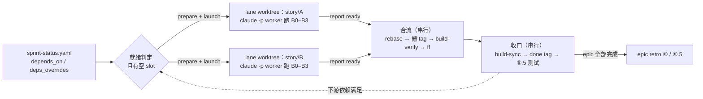
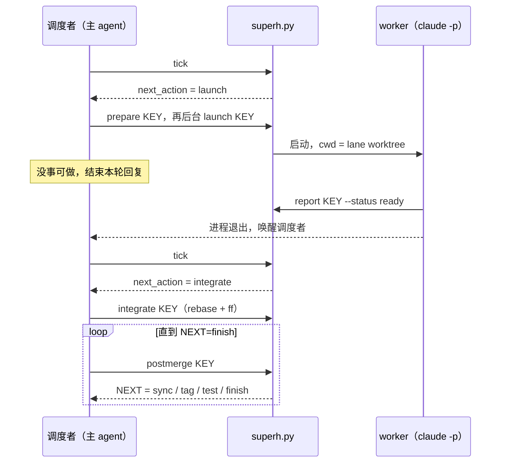
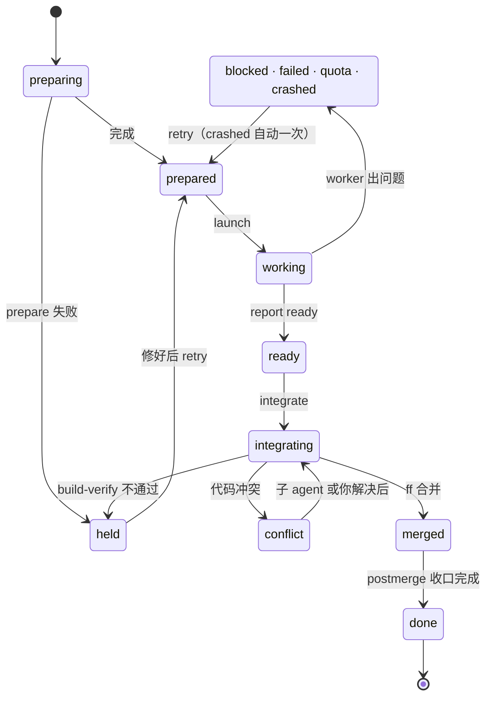

# super-harness

> [my-cc-plugin](../../README.md) marketplace 的一部分，安装方式见那里。

在 [BMad Method](https://github.com/bmad-code-org/BMAD-METHOD) 之上跑 sprint 的编排 plugin，面向一个开发者带多个 AI 子 agent 的工作方式。BMad 产出规划文档（PRD、architecture、epics、sprint-status），super-harness 按 `sprint-status.yaml` 把 backlog story 一条条推进完：每条 story 跑一次 `bmad-build-auto`（规划、实现、多层 review、commit），事后审计提交区间，codex 没挂进 build 时补一轮外部 codex review 和修复，按需再跑一轮 follow-up review，然后同步 sprint-status 和 deferred 账本、跑测试，epic 收尾时做 retrospective。

有两种跑法，走的是同一份流水线手册（`pipeline.md`）：

| 命令 | 怎么跑 | 适合 |
|---|---|---|
| `/super-harness:run-inline` | 单路，在当前会话里一条一条跑，每一步都看得见 | 调试、优化流水线；story 之间依赖不清楚 |
| `/super-harness:run` | 多路并行：互不依赖的 story 各开一个 git worktree、各起一个 headless Claude Code 进程同时跑，跑完按顺序合回 sprint 分支，再串行完成 build-sync、测试和 epic retro | 依赖已经声明清楚，想缩短整个 sprint 的时间 |

0.2.0 起 harness-zh 并入本 plugin，harness-zh 不再单独维护。从 harness-zh 迁移的步骤见下文「安装」。

单条 story 的执行手册是 [pipeline.md](pipeline.md)。harness 整体设计（部署模型、状态机、retro 闭环、config 提取）见 [architecture.md](architecture.md)，并行调度的设计见 [architecture-parallel.md](architecture-parallel.md)，思路来自 [deepseek-ai/dsh-superagent-prototype](https://github.com/deepseek-ai/dsh-superagent-prototype)。

## 并行调度一览

图文版在 [`docs/architecture.html`](docs/architecture.html)：单个文件，不依赖网络，克隆仓库后直接用浏览器打开。里面有 6 张图（整体结构、两路并行的时间线、tick 决策、lane 状态机、合流流程、收口），以及就绪规则、冲突处理、状态文件和失败恢复的对照表。下面是其中三张的简化版。

### 一条 story 怎么走完



并行的只有 worker 那一段（B0–B3，按 pipeline.md 的 lane 模式执行），各在自己的 worktree 和分支上。合流、收口、retro 要写共享账本或共用测试环境，在主 worktree 里一条一条做。

### 一轮调度



调度者的每个决定都来自 `superh.py` 的结构化输出。状态落在 `.git/super-harness/`，每个文件只有一个写入者，任何一步被打断，下次 tick 都能从磁盘接着走。

### 一条 lane 的状态



trouble、conflict、held 是需要你处理的状态，`/super-harness:board` 会把它们排在最前面。

## 前置条件

所有跑法都需要：

- BMad Method ≥ 6.11（实测 6.12.4），至少装 Core + BMM，跑测试循环还要 TEA；集成选 Claude Code，输出目录保持默认的 `_bmad-output`。安装：`npx bmad-method install`。
- [uv](https://docs.astral.sh/uv/)：BMad 6.12 通过 `uv run _bmad/scripts/render_skill.py` 启动每个 skill，没有 uv 时 `bmad-build-auto` 直接 HALT。安装：`curl -LsSf https://astral.sh/uv/install.sh | sh`。
- 项目用 BMad sprint-planning 生成了 `sprint-status.yaml`。

`/super-harness:run` 另外需要：

- git ≥ 2.38（合流用到 `git rebase --update-refs`）
- `claude` CLI 在 PATH 里（worker 是 headless `claude -p` 进程）

可选：codex plugin（`/plugin marketplace add openai/codex-plugin-cc`，`/plugin install codex@openai-codex`），用来做跨模型的对抗式 review。项目在 `_bmad/custom/bmad-build-auto.toml` 里把 codex 挂成 review layer 时，codex 在 `bmad-build-auto` 内部跑；没挂时流水线在 build 之后单独跑一轮。codex 不可用时 story 照常往下走，留下 `<KEY>.codex-skipped.json`，之后用 `/super-harness:codex-catchup` 补跑。

`/super-harness:run-inline` 和 `/super-harness:run` 启动时都会用 `scripts/check_bmad_runtime.sh` 检查 BMad、uv 和嵌套子 agent，缺了就停下并给出修复命令。

## 安装

```
/plugin install super-harness@my-cc-plugin
```

然后在项目根目录执行：

```
/super-harness:init
```

它把资产投递到 `.claude/harness/`，装 git pre-commit hook，检查并行调度的前置条件；BMad 规划文档已经齐的话，接着从中提取 16 个字段填 `harness-project-config.yaml`。并行配置 `.claude/harness/parallel.yaml` 只在不存在时投放，之后不会被覆盖。

plugin 升级后执行 `/super-harness:update`，它只刷新资产，不动两份配置。从 super-harness 0.1.0 升上来时，`.claude/super-harness/config.yaml` 会被原样搬到 `.claude/harness/parallel.yaml`，旧目录确认后可以删掉。

### 从 harness-zh 迁移

1. `/plugin install super-harness@my-cc-plugin`
2. 在项目根目录跑 `/super-harness:init`。`harness-project-config.yaml`、`harness/<KEY>/*` tag 和 sprint 状态都原样沿用。harness-zh 以前复制进 `.claude/commands/` 的命令副本会被备份后删除，你自己写的命令不受影响。
3. `/plugin uninstall harness-zh`。两个 plugin 都往 `.claude/harness/` 写资产，留着旧的，下次误跑 `/harness-zh:update` 会把资产刷回旧版。

做到一半的 story 用 `/super-harness:run-inline --continue` 接着跑。原来的 `/harness-zh:run` 对应现在的 `/super-harness:run-inline`，参数相同。

## 命令

| 命令 | 作用 | 什么时候用 |
|---|---|---|
| `/super-harness:init` | 首次 bootstrap：投递资产、装 hook、检查前置条件，BMad 文档齐时填 `harness-project-config.yaml`（merge 模式，支持 `--dry-run` / `--force`） | 每个项目一次；BMad 文档补齐后可重跑 |
| `/super-harness:update` | 升级 plugin 后刷新项目里的资产副本 | 每次 `/plugin marketplace update` 之后 |
| `/super-harness:run-inline` | 单路主循环，参数 `--story [<key>]` / `--epic [<num>]` / `--continue` / `--dry-run` | 日常，或调试流水线 |
| `/super-harness:run` | 多路并行调度，参数 `--slots <N>` / `--dry-run` | 依赖声明清楚之后 |
| `/super-harness:board` | 并行调度看板，先列需要你处理的 lane | 并行跑起来之后 |
| `/super-harness:run-test` | 单条 story 的 ATDD + E2E；流水线阶段 ⑤.5 自动调用，也可以单独跑 | 按需 |
| `/super-harness:codex-catchup` | 补跑因 codex 不可用而跳过的 review + 修复 | codex 恢复后 |
| `/super-harness:upgrade-deferred-work` | 复测 `deferred-work.md` 的 schema v1 符合度，在 advisory 和 strict 之间切换 | 按需 |
| `/super-harness:report-issue` | 自动收集版本、sprint 状态、halt 现场，用 `gh` 给 `Niutie/my-cc-plugin` 提 issue | halt 或想反馈时 |

## 让 story 能并行

`/super-harness:run` 只并行它确认互不依赖的 story。依赖信息有两个来源：

1. `sprint-status.yaml` 里的 `depends_on`（BMad 多行块格式）：

   ```yaml
   development_status:
     3-2-digest-delivery:
       status: backlog
       depends_on: [3-1-digest-model]
     3-3-email-template:
       status: backlog
       depends_on: []        # 明确声明独立
   ```

2. `.claude/harness/parallel.yaml` 的 `deps_overrides`，优先级更高。

两处都没写的 story，默认按串行处理（`no_deps_policy: serial`），这时一次只跑一路。确认同一 epic 内的 story 基本独立时，可以改成 `epic-parallel`。

依赖要等上游 story 合入并 build-sync 为 done 才算满足，所以下游 story 开工时一定能看到上游代码。

## 并行调度的使用

| 命令 | 作用 |
|---|---|
| `/super-harness:run --dry-run` | 预览：哪些 story 现在就能并行、其余在等什么 |
| `/super-harness:run` | 开跑，并发数取 `parallel.yaml` 的 `max_slots`（默认 2） |
| `/super-harness:run --slots 3` | 本次改用 3 路 |
| `/super-harness:board` | 看状态：先列需要你处理的 lane |

调度者在没事可做时会结束当前回复，某一路 worker 跑完时自动醒来继续。跑的过程中不要关掉这个 Claude Code 会话，否则在跑的 worker 会一起结束（下次运行时会自动续作一次）。

某一路出问题时只停这一路，其他照常推进。看板会给出接手方式：

```
cd <worktree> && claude --resume <session>                     # 进入那一路的会话
python3 .claude/harness/scripts/superh.py retry <KEY>          # 修好后让 worker 续作
python3 .claude/harness/scripts/superh.py abandon <KEY> --yes  # 放弃这一路
```

## 并行配置

`.claude/harness/parallel.yaml`，每一项都有注释。常改的几项：

| 键 | 默认 | 说明 |
|---|---|---|
| `max_slots` | 2 | 同时运行的 worker 数，token 消耗大致按它线性增长 |
| `no_deps_policy` | serial | 没写依赖的 story 怎么处理：`serial` / `epic-parallel` |
| `retro_barrier` | true | 下一个 epic 要等上一个 epic 的 retro done |
| `worktree_root` | `<仓库名>.worktrees`（仓库旁边） | lane worktree 放在哪 |
| `copy_paths` / `link_paths` | `.claude/harness`、`.claude/skills`、`_bmad` | 没进 git 的基建文件怎么带进 worktree。这些路径必须被 `.gitignore` 忽略，软链要写成不带结尾斜杠的 `/node_modules`；`superh.py doctor` 可以检查 |
| `prepare_command` | 空 | 开 lane 后执行的命令，例如 `pnpm install --frozen-lockfile` |
| `worker_permission_mode` | bypassPermissions | worker 的权限模式 |

项目本身的配置（产物目录、前端目录、验证命令、`retro_gate` 等）在 `.claude/harness/harness-project-config.yaml`，由 init 从 BMad 文档提取。

## 合流时会自动处理的冲突

每一路的 bmad-build-auto 都可能改 `sprint-status.yaml`、`deferred-work.md` 和 `epic-<N>-context.md`，合流时这三个文件由脚本自动处理：

| 文件 | 处理 |
|---|---|
| `sprint-status.yaml` | 取 sprint 分支版本，本 story 的状态随后由 build-sync 写回 |
| `deferred-work.md` | 两边新增的条目都保留 |
| `epic-<N>-context.md` | 缓存文件，取 sprint 分支版本 |

其他文件的冲突交给一个专门的子 agent 解决。它解决不了，这一路就停在冲突状态等你处理。

## 部署模型

plugin 是源，项目里的 `.claude/harness/` 是部署副本，运行时只读写副本，路径都相对项目根目录。这样做是因为 git pre-commit hook 跑在 git 的上下文里，拿不到 `${CLAUDE_PLUGIN_ROOT}`，命令里的 bash 块也不保证能拿到。命令文件不复制，由 plugin 以 `/super-harness:*` 提供。详见 [architecture.md](architecture.md) §〇。

## 测试

```bash
bash plugins/super-harness/scripts/run_all_tests.sh
```

先跑 `release_check.sh`（版本一致性、命令 frontmatter、流水线手册的协议回流检查），再跑 `scripts/` 下所有 `*_test.sh`。其中 `superh_test.sh` 用一个假的 `claude` 可执行文件扮演 worker，在临时仓库里跑完就绪判定、开 lane、启动、两路并行合流（含账本冲突自动消解和 tag 搬迁）、代码冲突、重试和放弃，不消耗 token。CI 见仓库的 `.github/workflows/ci.yml`。

## 版本

| 版本 | 日期 | 要点 |
|---|---|---|
| 0.2.2 | 2026-11-03 | 修 macOS 自带 bash 3.2 下 pre-commit 的 gate ①：`retro_gate=warn` 时也会拦下新 story spec 的 commit，现在恢复为只警告。`release_check.sh` 加了一项静态检查，防止同类写法再进来。 |
| 0.2.1 | 2026-11-03 | 修两个从 harness-zh 带过来的问题。装 git hook 时不再覆盖项目自己的 pre-commit（例如 pre-commit 框架写的），改为保留原 hook、给出串接办法并以退出码 3 提示；确认要覆盖时用 `HARNESS_HOOK_FORCE=1`。run-test 的 T4 改用环境探测出的包管理器跑 e2e，npm / yarn / bun 项目不再撞上写死的 `pnpm e2e`。 |
| 0.2.0 | 2026-11-02 | 并入 harness-zh 0.2.1，不再依赖单独安装的 harness-zh。新增单路命令 `/super-harness:run-inline`；harness-zh 的 run.md 拆成 `pipeline.md`（单条 story 流水线，inline、lane、调度三种模式共用）和 `commands/run-inline.md`。资产统一部署到 `.claude/harness/`，并行配置改为 `.claude/harness/parallel.yaml`，命令不再复制进 `.claude/commands/`。 |
| 0.1.0 | 2026-11-02 | 多路并行调度层首版，依赖项目里部署的 harness-zh ≥ 0.2.1。 |

完整记录见 [changelog.md](changelog.md)，harness-zh 0.1.0 到 0.2.1 的历史也在里面。
